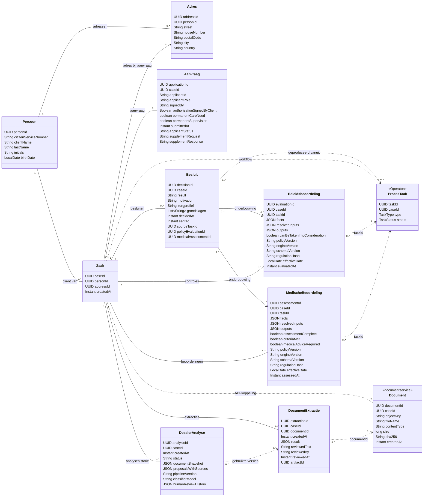

# Actueel klassendiagram van zaken

Bijgewerkt op 14 oktober 2026. Persoon, Adres, Aanvraag en Zaak worden door de zaakservice opgeslagen. Beleidsbeoordeling, MedischeBeoordeling en Besluit worden via de assessment-service in een eigen database opgeslagen. BAS heeft een eigen database voor OCR, dossieranalyses en menselijke broncontroles. Relaties tussen domeinen zijn identificaties via API's en events; er zijn geen gedeelde databases. Historische records worden idempotent via import-API's overgenomen. Technische outbox-records zijn voor de leesbaarheid weggelaten.

Een persoon kan meerdere zaken hebben. De zaak bevat alleen identificatie, verwijzingen en de aanmaaktijd. Elke nieuwe aanvraag krijgt een eigen adresrecord en een eigen zaak.

Aanvraag bevat ook `submissionChannel` (cliëntportaal, zorgaanbieder of post), onafhankelijk van indiener en ondertekenaar. Een concept heeft nog geen `submittedAt` en geen workflow. Cliënt en zorgaanbieder kunnen bijlagen bij hun aanvraag of gevraagde aanvulling voegen; AO uploadt buiten de portalen ontvangen documenten. De Onderzoeker controleert en behandelt de aanvraag. Originale OCR-eenheden staan als JSON-artefact in S3 via de documentservice. BAS bewaart document-/extractieversies, onbetrouwbare voorstellen met bronverwijzingen en een append-only menselijke reviewhistorie. Een ernstscore kan 0–4 of leeg (niet beoordeeld) zijn. Dit introduceert geen extra CIZ/BI-model: stoornissen en beperkingen blijven eenvoudige bevindingen binnen het analyseresultaat, afzonderlijk van bevestigde RegelRecht-feiten.

Een besluit is een afzonderlijk record. Nieuwe besluitvorming voegt een besluit toe; verzending markeert het nieuwste besluit. Zorgprofiel en grondslagen zijn eenvoudige tekstwaarden. Een besluit verwijst naar de laatste beschikbare beleids- en medische beoordeling op het moment van besluitvorming en naar de producerende taak. Deze beoordelingen behouden hun feiten, uitkomsten en regelversies; latere beoordelingen veranderen de verwijzingen van oudere besluiten niet.

Ten opzichte van het eerder aangeleverde wensdiagram zijn er deze concrete verschillen:

- Er is geen abstracte opgeslagen klasse `Beoordeling`; beleidsbeoordelingen en medische beoordelingen zijn afzonderlijke entiteiten met vergelijkbare herkomstvelden.
- Vertegenwoordiging en ondertekening staan als velden op `Aanvraag`; er is geen afzonderlijke `Vertegenwoordiging`-entiteit. De aanvrager is een `applicantId`, niet een aparte relatie naar een tweede `Persoon`.
- De voortgangsstatus staat op `Aanvraag` als `applicantStatus`. Operaton beheert de procesvolgorde en taken.
- Taken en documentmetadata zijn eigendom van andere diensten. De gestippelde relaties zijn verwijzingen via API's en identifiers, geen gedeelde database-relaties.

Bronnen: de OpenAPI-contracten voor case-, BAS-, assessment- en documentservice en hun Java-entiteiten. De assessment-service slaat de getypeerd gevalideerde beoordelings- en besluitrecords op met hun volledige payload en audit. Oude case-tabellen blijven beschikbaar voor idempotente historische migratie.
